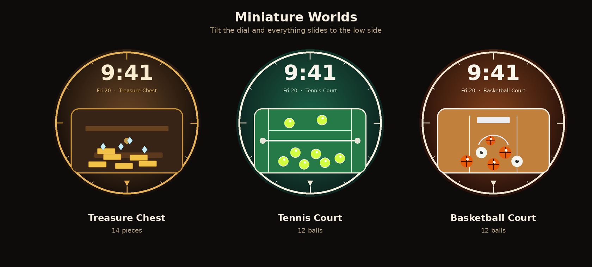
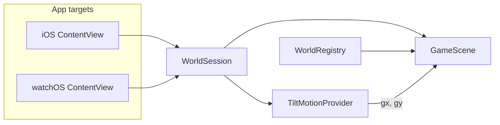

# Miniature Worlds

A small interactive world that looks like a watch face. Balls, bars, and gems slide and pile at the lowest point of the dial as you tilt your wrist.

It is an iPhone app and a standalone Apple Watch app (also installed as the iPhone app's companion). Both hosts are SwiftUI. The world itself is one SpriteKit scene, shared by the two targets. There are no third-party packages and no image assets required for the scene — shapes and gradients are drawn in code.



*Design preview, drawn to show the three worlds. It is not a simulator screenshot — this prototype was prepared on Linux, where Xcode cannot run. The first real render is on your Mac.*

The Worlds button (the grid icon at the lower right of the dial) switches themes. The choice is remembered.

| World | What piles up |
| --- | --- |
| Treasure Chest | 8 gold bars and 6 diamonds. Bars are heavy and sticky; gems bounce and end up on top. |
| Tennis Court | 12 tennis balls against a net. |
| Basketball Court | 7 basketballs and 5 soccer balls, with a rim that can catch one. |

Concept notes, physics numbers, and ideas that are not built yet are in [docs/WORLD_CONCEPTS.md](docs/WORLD_CONCEPTS.md).

## Open and run

You need a Mac with **Xcode 15 or later** (the deployment targets are iOS 17 and watchOS 10). No extra tools — the `.xcodeproj` is already in the repo.

```bash
git clone https://github.com/Zath-ara/miniature-worlds.git
cd miniature-worlds
open MiniatureWorlds.xcodeproj
```

### Signing

Nothing in the project picks a Team, and no account or App Store settings are touched.

1. Select the **MiniatureWorlds** target → **Signing & Capabilities** → set **Team** to your Personal Team (or whatever team you use).
2. Do the same for **MiniatureWorldsWatch**.

Bundle ids are placeholders:

- iPhone: `com.zathara.miniatureworlds`
- Watch: `com.zathara.miniatureworlds.watch`

If you change the iPhone id, also change `WKCompanionAppBundleIdentifier` in `MiniatureWorldsWatch/Info.plist` so it still matches. The watch app is allowed to run without the iPhone app (`WKRunsIndependentlyOfCompanionApp`).

If Xcode says a target "requires a development team", that is this step. It applies to a device and, on some Xcode versions, to the simulator as well.

### iPhone simulator

1. Scheme: **MiniatureWorlds**.
2. Destination: an iPhone simulator (portrait).
3. Run.

The simulator has no accelerometer. The label under the tray reads **Crown or drag**. Drag on the dial: the point you touch becomes "down", and the pieces slide there. A tap tosses the pile. A long-press scatters it.

The iPhone build also embeds the watch app, so the first build compiles both targets.

### Apple Watch simulator

1. Scheme: **MiniatureWorldsWatch**.
2. Destination: an Apple Watch simulator.
3. Run.

If the destination list is empty, open **Window → Devices and Simulators**, add a watch simulator, and pair it with an iPhone simulator if Xcode asks.

On the watch simulator, use the **Digital Crown** to rotate which way is down (a full turn spins "down" all the way around the face). Drag still works with the pointer. Crown haptics are off on purpose, so spinning it does not buzz.

You can also run the **MiniatureWorlds** scheme and pick a paired destination such as "iPhone + Apple Watch". That installs both apps.

### A real iPhone

1. Plug in the phone, trust the computer, and unlock it.
2. Select your Team (above) and the phone as the destination. Run.
3. The first launch asks for **Motion & Fitness** access. The reason string is `NSMotionUsageDescription` in `MiniatureWorlds/Info.plist`.
4. Tilt the phone. Pieces accelerate toward the low side of the glass. Lay it flat and they rest.

If you deny motion, open the Worlds screen and turn on **Use crown and drag**. You can also allow motion later in Settings → Privacy & Security → Motion & Fitness.

Developer Mode: on iOS 16 and later, a device that will run a development-signed app needs **Settings → Privacy & Security → Developer Mode**.

### A real Apple Watch

1. Pair the watch with the iPhone you just set up. Both must be unlocked.
2. On the watch: **Settings → Privacy & Security → Developer Mode**, then restart the watch if it asks. Trust the computer if prompted.
3. In Xcode: **Window → Devices and Simulators** and confirm the watch shows up under the phone.
4. Select your Team on **both** targets. Destination: the paired watch. Scheme: **MiniatureWorldsWatch** (or the iPhone scheme with the paired watch destination). Run.
5. The watch asks to use motion. The reason string is `NSMotionUsageDescription` in `MiniatureWorldsWatch/Info.plist`.
6. Turn your wrist. The pile follows. Drop your wrist (screen off / app inactive) and motion sampling stops.

The watch app is embedded in the iPhone app, so installing from the iPhone scheme also copies it to the paired watch. It can also be launched on its own.

## How tilt works

`TiltMotionProvider` reads `CMDeviceMotion.gravity` when the hardware has it.

That vector points at the ground in the device frame, in units of g:

- **+x** toward the right of the screen
- **+y** toward the top of the screen
- **+z** out of the glass, toward you

SpriteKit uses the same x and y. The scene sets:

```text
physicsWorld.gravity = (gravity.x, gravity.y) × scale
```

`scale` is about `1100` points/s² per g on a 190-point dial, and grows with the dial so a big iPhone circle feels like the watch. **Z is ignored.** Face-up on a table, gravity is about `(0, 0, −1)`, so x and y are ~0 and the pile rests. Tip the top of the watch down and `gravity.y` becomes positive, so pieces slide toward the top of the face — the side that is actually lower.

Samples are smoothed with a 0.12 s exponential filter (`GravitySmoother`) before they touch the physics world. Sleeping bodies are woken only when the vector changes, so a steady wrist does not keep nudging the solver.

A small arrow on the inner bezel points downhill, and fades when the face is level.



A static copy of that picture is in [docs/architecture.svg](docs/architecture.svg).

### When there is no motion sensor

`CMMotionManager.isDeviceMotionAvailable` is false in the simulator. The provider then ignores the accelerometer and takes tilt from:

- **Drag** — the touch point on the dial is the low side. It stays where you left it when you lift your finger.
- **Digital Crown** (watch) — the crown angle is the downhill direction. Straight down at the bottom of the face is the resting position.

On a real device those inputs are ignored unless you turn on **Use crown and drag** in Worlds. Turning that on also stops accelerometer updates.

### Clock

Hours and minutes (12-hour, no AM/PM) and the date sit in the upper bezel as a SwiftUI overlay, outside the physics tray, so the pile cannot cover the time. The overlay updates once a second.

### Haptics

A contact with a wall or a fixed obstacle plays a haptic only when the body was moving **into** the surface (not sliding along it) faster than 240 points per second, and at most once every 0.14 seconds. Watch uses `WKInterfaceDevice.play(.click)`. iPhone uses `UIImpactFeedbackGenerator` (light, or medium for a harder hit).

## Adding a world

A world is data: colors, a list of bodies, a few fixed obstacles, and optional painted lines. `GameScene` builds the nodes. You do not copy the physics or motion code.

1. Add `Shared/Worlds/YourWorld.swift` with a type that conforms to `MiniatureWorld`. Copy `TennisCourtWorld` as a starting point. Keep the body count in the 8–20 range. Sizes are points on a 190-point dial.
2. Append an instance to `WorldRegistry.all` in `Shared/MiniatureWorld.swift`.
3. In Xcode, add the new file to **both** targets' **Compile Sources** (the project lists files explicitly; a file on disk is not compiled until it is a member of a target).

The Worlds screen picks it up from the registry. The id string is what `@AppStorage("selectedWorldID")` saves.

`MiniatureWorld` fields worth knowing:

- `bodies` — dynamic pieces. `mass`, `friction`, `restitution`, and damping are SpriteKit values. Circles can use a seam style (tennis, basketball, soccer); the texture is generated at runtime.
- `obstacles` — static bars, posts, and open arcs, placed in tray units from −1 to 1.
- `decorations` — lines and dots with no physics (court paint, rivets).
- `wallFriction` / `wallRestitution` — the tray's edge loop.

## Battery

The scene is meant to sit on a wrist, so it stays quiet when nobody is looking.

- Motion updates are **30 Hz on watch** and **60 Hz on iPhone** (`MotionBudget`). There is no display link and no spin loop of our own; `CMMotionManager` delivers samples, and SpriteKit steps the world.
- The watch scene is capped at **30 fps**. The phone scene runs at 60.
- When `scenePhase` is not `.active` — app backgrounded, wrist down, cover closed — `WorldSession` pauses the SpriteKit scene and calls `stopDeviceMotionUpdates()`.
- Crown detent haptics are disabled. Impact haptics are rate-limited.
- Body counts stay in the teens, and bodies are allowed to sleep while gravity is steady.

Motion never leaves the device. The app does not use the network.

## Roadmap

More dials that use the same tilt-and-pile rule. Notes on each are in [docs/WORLD_CONCEPTS.md](docs/WORLD_CONCEPTS.md).

- Sand tray — many grains, still inside the watch body budget.
- Marbles maze — static walls, one marble or a few.
- Snow globe — low gravity, shake stirs it, flakes settle.
- Hourglass — a throat between two chambers.
- Tide pool — shells and stones with very different weights.
- Pinball — tap-driven flippers, tilt still moves the ball.

Per-world ideas already sketched: a treasure lid on the crown, a tennis serve, and a made basket that scores.

## Project layout

```text
MiniatureWorlds.xcodeproj    Xcode project and shared schemes
MiniatureWorlds/             iOS app entry, Info.plist, icon
MiniatureWorldsWatch/        watchOS app entry, Info.plist, icon
Shared/                      scene, motion, haptics, SwiftUI dial
Shared/Worlds/               Treasure Chest, Tennis Court, Basketball Court
docs/WORLD_CONCEPTS.md       themes and physics numbers
docs/architecture.svg        how the pieces connect
docs/images/dial-preview.png design preview used above
```

| File | Role |
| --- | --- |
| `Shared/ContentView.swift` | `SpriteView`, clock overlay, crown, drag, settings button |
| `Shared/GameScene.swift` | Dial, tray, physics, impacts |
| `Shared/TiltMotionProvider.swift` | `CMMotionManager`, smoothing, manual tilt |
| `Shared/MiniatureWorld.swift` | `MiniatureWorld` protocol and `WorldRegistry` |
| `Shared/SettingsView.swift` | Theme list, `@AppStorage` |
| `Shared/ImpactFeedback.swift` | Watch and iPhone haptics |

## Troubleshooting

- **Signing error on either target.** Set the Team on both targets. Confirm the watch bundle id is still the iPhone id plus `.watch`, and that `WKCompanionAppBundleIdentifier` matches the iPhone id.
- **Watch destination missing.** Pair a watch simulator with an iPhone simulator, or pair the hardware watch in Devices and Simulators. Developer Mode has to be on for a real watch.
- **Pieces never move on device.** Allow Motion access, or turn on **Use crown and drag**. Flat on the table is correct behavior: there is no downhill direction in the plane of the glass.
- **Crown does nothing.** On a real watch the crown is ignored while wrist tilt is active. Turn on **Use crown and drag**, or use the simulator, where manual tilt is automatic.
- **"Multiple commands produce Info.plist".** `Info.plist` should be the target's Info.plist file only, not a member of Copy Bundle Resources.
- **New world does not appear.** It needs to be in `WorldRegistry.all`, and the Swift file needs to be in Compile Sources for the target you are running.
